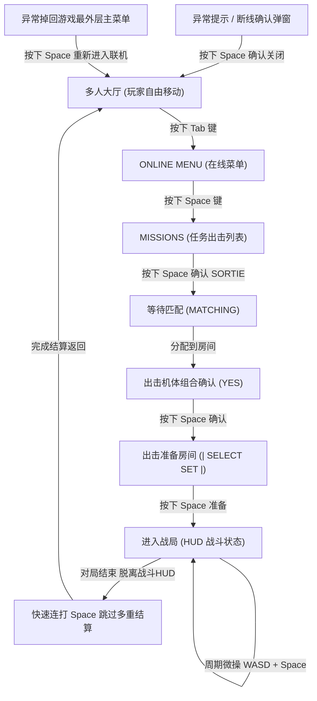

# MAAACOL - Ace Combat Online 自动化辅助工具

<p align="center">
  
</p>

<div align="center">

**MAAACOL** 是专为《皇牌空战OL》(ACE COMBAT 8 : WINGS OF THEVE) 打造的新一代多人联机模式自动化对战与挂机辅助工具。  
作者：**[HK560](https://space.bilibili.com/7342356)**（Bilibili）  
基于 **[MaaFramework](https://github.com/MaaXYZ/MaaFramework)** 图像识别框架与 **[MFAAvalonia](https://github.com/SweetSmellFox/MFAAvalonia)** 跨平台图形前端构建。

[](https://space.bilibili.com/7342356)
[](https://github.com/MaaXYZ/MaaFramework)
[](https://github.com/SweetSmellFox/MFAAvalonia)
[](LICENSE)
[](#)

</div>

---

## 目录

- [核心功能与特性](#核心功能与特性)
- [使用方式与前置步骤（必读）](#使用方式与前置步骤必读)
- [图形界面 (GUI) 接入与使用指南](#图形界面-gui-接入与使用指南)
- [命令行 (CLI) 终端运行方式](#命令行-cli-终端运行方式)
- [自动化状态流转逻辑](#自动化状态流转逻辑)
- [本地开发与打包指南](#本地开发与打包指南)
- [常见问题与排查 (FAQ)](#常见问题与排查-faq)
- [免责声明](#免责声明)

---

## 核心功能与特性

- **双端支持**：既可通过精美的 **MFAAvalonia 图形界面 (GUI)** 进行可视化参数配置与一键启动，也可通过 **纯英文批处理脚本 (CLI)** 极速控制台挂机。
- **自定义挂机限制**：支持灵活编辑**目标完成场次**与**最长运行时长（分钟）**，达成任一条件即自动安全收工停留在游戏大厅，防止过度刷取。
- **硬件级按键仿真**：基于 Windows `SendInput` 硬件扫描码仿真实现，完美兼容虚幻引擎（Unreal Engine）窗口原生输入。
- **纯黑盒视觉驱动**：完全依赖 OCR 高精度识别与图像匹配，无需注入任何游戏内存，安全可靠。
- **全局自愈与防挂机保护**：
  - 战斗期间自动周期性执行航向微调与巡航按键（WASD + Space 机动），规避局内消极挂机判定；
  - 战局结束后极速连按跳过结算评分与多层动画；
  - 遭遇网络波动弹窗（OK）自动确认关闭，异常掉出大厅时自动重进。

---

## 使用方式与前置步骤（必读）

为了确保自动化流程 100% 准确命中您想要挂机的模式，请在启动脚本或 GUI 之前完成以下简短前置操作：

```
[启动游戏] 
   └── 1. 手动进入多人联机模式 (ACE COMBAT ONLINE)
         └── 2. 自行进入出击列表，选择好要挂机的对战模式 (不限模式，支持任意玩法)
               └── 3. 退回到多人大厅 (此时机师角色可在场景内自由移动)
                     └── 4. 在 GUI 或 CLI 中设置挂机【次数】与【时长】
                           └── 5. 点击【开始】运行！
```

> [!IMPORTANT]
> **【推荐游戏画面设置】**
> - **显示模式**：强烈推荐设置为 **窗口化 (Windowed)**；
> - **画面分辨率**：强烈推荐设置为 **1280x720** 分辨率（保持 16:9 标准比例，视觉识别率最高、占用资源最少且稳定性最佳）。

### 详细步骤说明：

1. **手动进入多人模式**：启动游戏客户端，在主选单中手动进入 `ACE COMBAT ONLINE`。
2. **选择目标挂机模式**：打开出击列表（MISSIONS），自行选择好希望挂机的具体玩法（**不限模式**，支持团队死斗、混战等任意模式）。*（游戏引擎会自动记忆您最后一次选中的模式）*。
3. **退回至大厅主界面**：退出各级菜单，回到**多人大厅主界面**（即画面右下角出现 `[Tab] 在线菜单 / 互动` 提示、机师角色可以在大厅内自由移动控制的画面）。
4. **编辑挂机参数**：
   - 打开辅助工具，设置本次挂机的**目标场次**（如 10 局，填 0 表示不限）；
   - 设置本次挂机的**最长时长**（如 60 分钟，填 0 表示不限）。
5. **开启运行**：点击 GUI 右下角的【开始】按钮（或在 CLI 终端中确认），程序将自动接管呼出菜单、自动匹配、出击确认、局内机动与结算跳过！

---

## 图形界面 (GUI) 接入与使用指南

本项目已全面深度接入 **MFAAvalonia** 图形化桌面客户端。

### 1. 启动图形界面

双击项目根目录下的启动脚本：

```text
start_gui.bat (或直接双击运行 MAAACOL.exe)
```

> **提示**：启动脚本会自动检索虚拟环境 Python，若首次运行未检测到 GUI 运行库，脚本会智能提示一键下载与组装。

### 2. 界面配置与使用步骤

1. **选择控制器**：
   - 在左侧控制器列表中选择 `PC 桌面端`；
   - 确保游戏窗口已启动（窗口标题匹配 `ACE COMBAT 8 : WINGS OF THEVE`，建议设置为 1280×720 窗口化运行）。
2. **勾选任务**：
   - 在任务列表中勾选 **`多人联机自动对战挂机`**。
3. **编辑挂机参数**：
   - 点击该任务右侧的设置面板展开参数编辑区：
     - **挂机目标场次**：输入期望完成的对局数量（默认 `10`，输入 `0` 表示不限制场次直到超时或手动停止）；
     - **挂机最长时长 (分钟)**：输入最大允许运行的时长（默认 `60` 分钟，超时后安全停止）。
4. **开始运行**：
   - 点击界面右下角的 **【开始】** 按钮；
   - 界面下方的实时日志面板会清晰打印当前识别到的画面状态、出击进度、战局历时与累计完成局数。
5. **随时停止**：
   - 点击界面右下角的 **【停止】** 按钮，核心调度引擎内置高灵敏打断机制，将在 100ms 内安全停止动作。

---

## 命令行 (CLI) 终端运行方式

如果您偏好极简无界面的控制台终端挂机，可直接使用纯 ASCII 命令行脚本：

### 1. 双击运行

双击项目根目录的：

```text
run_tdm.bat
```

### 2. 终端交互输入

终端将以纯英文提示输入挂机参数（直接按回车可选用默认值）：

```text
=======================================================
       Ace Combat Online - Multiplayer Battle Runner
=======================================================

[Pre-requisite Instructions]
1. Manually enter Multiplayer mode in game.
2. Choose your desired game mode (any mode supported).
3. Return to Multiplayer Lobby (where your character can freely move).
4. Configure rounds and max duration below to start.
[Recommendation] Strongly recommend setting game to Windowed 1280x720 resolution.

Target rounds [Default 10, 0 for unlimited]: 10
Max minutes [Default 60, 0 for unlimited]: 60

Starting: rounds=10, max_minutes=60...
Press Ctrl+C anytime to stop.
```

### 3. 直接通过 Python 传参运行

```powershell
python run_tdm.py --rounds 20 --minutes 120
```

---

## 自动化状态流转逻辑

调度引擎采用状态机（State Machine）对游戏全生命周期进行闭环托管：



---

## 本地开发与打包指南

本项目严格遵循团队规范：
- **批处理规范**：所有 `*.bat` 脚本及其输出强制采用纯 ASCII 英文，杜绝代码页乱码及换行解析故障；
- **代码规范**：标识符全英文，中文注释与文档。

### 常用维护命令

双击根目录 `build_local.bat` 即可呼出打包与维护菜单：

- **[1] Fast Local Build**：极速本地增量打包（利用本地已有运行组件，耗时约 5 秒生成 zip 产物）；
- **[2] Clean Full Build**：全新干净全量打包（自动从 GitHub Release 下载最新的 MaaFramework 与 MFAAvalonia 前端并自动化组装）；
- **[3] Fast Sync to gui/**：一键同步最新的流水线资源 (`assets/resource`)、配置 (`interface.json`) 与代码至 `gui/` 调试目录；
- **[4] Setup gui/ Environment**：全新一键配置本地开发所用的 `gui/` 运行环境。

---

## 常见问题与排查 (FAQ)

### Q1: 为什么启动后一直停在游戏大厅，不按 Tab 呼出菜单？
- **排查**：请确认游戏当前画面右下角是否显示了 `[Tab] 在线菜单 / 互动` 图标。若处于某些对话弹窗或输入状态，脚本会暂停操作。
- **分辨率与窗口**：请确保游戏以 **1280×720 窗口化** 或保持 16:9 标准比例运行，避免极端拉伸。

### Q2: 为什么匹配出击时进入了其他模式？
- **原因**：脚本为纯黑盒非侵入式设计，依赖游戏记忆最后一次选中的模式。
- **解决**：请务必在运行前**手动进入一次多人模式的出击列表，选中您希望挂机的模式（支持任意多人对战模式）**，再退回到大厅让程序接管。

### Q3: 战局结束后会卡在结算页面吗？
- 结算界面通常包含战斗评级、积分榜、经验加成等多页。调度器在战局结束进入结算阶段时会高频连发确认键，同时轻量检测大厅特征，一回到大厅立即停止连发并平稳进入下一轮循环。

---

## 免责声明

1. 本项目仅供游戏自动化黑盒测试、图像识别算法与技术交流学习使用；
2. **账号安全免责**：本工具**不对任何形式的游戏封禁、封号等账号处罚承担任何责任**。作者仅在多个账号上进行过长时使用测试且未见异常，但无法保证游戏官方检测规则的更新或调整；
3. 请合理控制挂机频率与运行时长，自行评估并承担使用风险。
